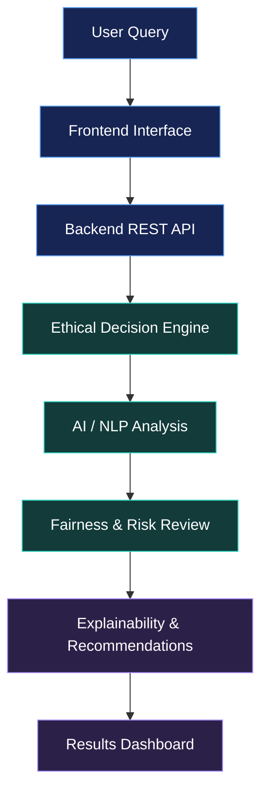

<!-- AECE | Autonomous Ethical Cognition Engine -->
<div align="center">


<h3>Building AI that reasons with responsibility.</h3>

<p>An AI-powered ethical decision-support system designed to examine user inputs for ethical concerns and produce transparent, explainable recommendations.</p>

<p><a href="https://aece-8hpg.vercel.app/"><strong>↗ OPEN LIVE DEMO</strong></a> &nbsp; • &nbsp; <a href="https://github.com/sakthi2006-creater/AECE-project">SOURCE CODE</a> &nbsp; • &nbsp; <a href="#-how-it-works">HOW IT WORKS</a></p>


</div>

---

## ✦ Why AECE?

AI can generate answers quickly, but important decisions also require **context, fairness, safety, and understandable reasoning**. AECE explores how ethical reasoning principles can become part of an AI decision-making workflow.

> **Project vision:** make AI-assisted decisions more transparent, accountable, and human-centred.

## ◈ Core capabilities

<table>
<tr>
<td width="50%" valign="top"><h3>⚖️ Ethical analysis</h3>Review inputs against defined ethical principles and highlight potential concerns.</td>
<td width="50%" valign="top"><h3>🔍 Explainable reasoning</h3>Present understandable explanations for assessments and recommendations.</td>
</tr>
<tr>
<td width="50%" valign="top"><h3>🧭 Bias awareness</h3>Identify potential fairness and bias issues for further review.</td>
<td width="50%" valign="top"><h3>🛡️ Risk assessment</h3>Surface possible safety or harm-related risks in a submitted scenario.</td>
</tr>
<tr>
<td width="50%" valign="top"><h3>💡 Recommendations</h3>Generate structured, ethics-aware suggestions to support human judgement.</td>
<td width="50%" valign="top"><h3>🧩 Modular architecture</h3>Organise the interface, API, analysis logic, and data layer into maintainable components.</td>
</tr>
</table>

<sub>Note: These are intended capabilities; analysis quality depends on implemented rules, models, and data. AECE supports human judgement and does not replace human review or professional advice.</sub>

---

## 🧠 How it works

<div align="center">
<table>
<tr><td align="center"><strong>01 · INPUT</strong><br/>User submits a scenario</td><td align="center">→</td><td align="center"><strong>02 · ANALYSE</strong><br/>Ethical concern detection</td></tr>
<tr><td align="center">↓</td><td align="center"> </td><td align="center">↓</td></tr>
<tr><td align="center"><strong>03 · EVALUATE</strong><br/>Bias, fairness, and risk review</td><td align="center">→</td><td align="center"><strong>04 · EXPLAIN</strong><br/>Reasons and recommendations</td></tr>
</table>
</div>

### System architecture



---

## ⚙️ Technology stack

<div align="center">


<br/>


</div>

| Layer | Technologies / role |
|---|---|
| Frontend | HTML5, CSS3, JavaScript, Bootstrap |
| Backend | Node.js, Express.js, REST API |
| Database | PostgreSQL |
| AI / reasoning | Python, ethical rule engine, NLP concepts |
| Tools | VS Code, Git, GitHub, Postman |

---

## 📁 Project structure

```text
AECE-project/
├── frontend/
│   ├── css/
│   ├── js/
│   ├── images/
│   └── index.html
├── backend/
│   ├── routes/
│   ├── controllers/
│   ├── middleware/
│   ├── models/
│   ├── server.js
│   └── package.json
├── database/
├── docs/
├── README.md
└── LICENSE
```

---

## 🚀 Run locally

### 1. Clone the repository

```bash
git clone https://github.com/sakthi2006-creater/AECE-project.git
cd AECE-project
```

### 2. Install backend dependencies

The project structure places the Node.js application in `backend/`:

```bash
cd backend
npm install
```

### 3. Configure environment variables

If required by the backend, create a local `.env` file with the database connection and server settings. Never commit passwords, API keys, or other secrets; use an `.env.example` file to document variable names.

### 4. Start the backend

Check the `scripts` section in `backend/package.json` for the actual project command. Common options are:

```bash
npm start
```

Or, if no start script exists:

```bash
node server.js
```

Run these commands from the `backend/` directory. The correct command depends on the current project configuration.

### 5. Open the live demo

**[Launch AECE](https://aece-8hpg.vercel.app/)** · Hosted demo

---

## 🗺️ Roadmap

- [x] Initial project and web demo
- [ ] Expand ethical rules and test scenarios
- [ ] Strengthen explanations for each assessment
- [ ] Add evaluation datasets and bias-testing metrics
- [ ] Explore an optional language-model analysis layer
- [ ] Add multilingual and voice experiences
- [ ] Add authentication and admin tools
- [ ] Improve monitoring and audit history

---

## 🤝 Contributing

Ideas, feedback, bug reports, and pull requests are welcome.

1. Fork this repository.
2. Create a branch: `git checkout -b feature/your-feature`
3. Make and test your changes.
4. Commit: `git commit -m "Add your feature"`
5. Push: `git push origin feature/your-feature`
6. Open a pull request with a clear summary.

Please avoid committing secrets, private data, or unverified claims about model performance.

## 👨‍💻 Author

<div align="center">

### Sakthivel R
**B.Tech · Artificial Intelligence & Data Science**  
Loyola Institute of Technology

[](https://github.com/sakthi2006-creater)
[](https://aece-8hpg.vercel.app/)

</div>

---

## 📄 License

This project is released under the **MIT License**. See [`LICENSE`](LICENSE) for details.

<div align="center">

### Responsible AI starts with better questions.

If AECE interests you, consider giving the repository a ⭐ and sharing feedback.


</div>
