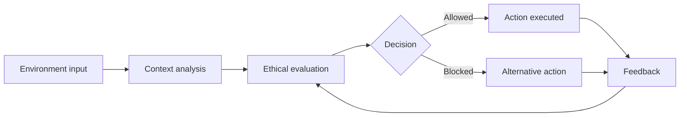

<div align="center">


<br/>


</div>

---

## 📑 Table of contents

- [Overview](#-overview)
- [Key features](#-key-features)
- [How it works](#-how-it-works)
- [Tech stack](#-tech-stack)
- [Project structure](#-project-structure)
- [Getting started](#-getting-started)
- [Demo](#-demo)
- [Research paper](#-research-paper)
- [Roadmap](#-roadmap)
- [Author](#-author)

---

## 🧠 Overview

**AECE (Autonomous Ethical Cognition Engine)** is an AI-based ethical decision-making system for autonomous environments. It acts as a **moral intelligence layer**: before an autonomous system acts, AECE evaluates the decision against ethical principles in real time.

> Autonomous systems are getting more capable every day. AECE focuses on making sure they are also getting more responsible.

---

## ✨ Key features

| Feature | Description |
|---|---|
| 🤖 Ethical decision-making | Evaluates actions against ethical rules before execution |
| ⚡ Real-time evaluation | Decisions are assessed as the environment changes |
| 🔄 Self-evolving layer | The moral layer adapts based on outcomes and feedback |
| 🧩 Modular design | Built as a layer that can sit on top of autonomous systems |

---

## 🔬 How it works



---

## 🛠️ Tech stack

<p>
  
</p>

- **Language:** Python
- **Core:** AI models for ethical reasoning and evaluation

---

## 📁 Project structure

```
AECE/
├── AECE_PROJECT/     # main source code
└── README.md
```

---

## 🚀 Getting started

**1. Clone the repository**

```bash
git clone https://github.com/sanjaysambat/AECE.git
cd AECE/AECE_PROJECT
```

**2. Install requirements**

```bash
pip install -r requirements.txt
```

**3. Run the project**

```bash
python main.py
```

---

## 🎥 Demo

[▶ Watch the demo video](https://getshared.com/cdllc9xx)

---

## 📄 Research paper

| | |
|---|---|
| **Title** | Autonomous Ethical Cognition Engine (AECE): A Self-Evolving Moral Intelligence Layer for Autonomous Systems |
| **Conference** | 2nd International Conference on Modern Trends in Engineering, Science, Management, and Technology (MESMT-2026) |
| **Date** | 21-22 March 2026 |
| **Organized by** | Tirunelveli Dhakshina Mara Nadar Sangam College in association with Xavier Institute for Research and Development |

---

## 🗺️ Roadmap

- [x] Core ethical evaluation engine
- [x] Real-time decision evaluation
- [x] Research paper presented at MESMT-2026
- [ ] Web dashboard to visualize decisions
- [ ] More ethical rule sets and test scenarios
- [ ] Documentation and unit tests

---

## 👨‍💻 Author

**Sanjay S**
B.Tech Artificial Intelligence and Data Science, Loyola Institute of Technology, Chennai

[](https://www.linkedin.com/in/sanjay-s-13119b405)
[](https://github.com/sanjaysambat)
[](mailto:sanjaytsm2005@gmail.com)

<div align="center">

⭐ If you find this project interesting, give it a star ⭐

</div>
